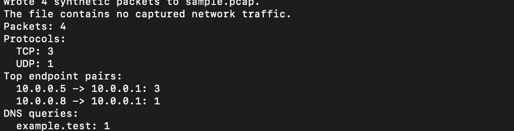

# PCAP Traffic Analyzer

A Python command-line tool that reads a saved packet capture and summarises transport protocol counts, endpoint pairs, and DNS query names.

**Author:** Jason Santos Ritchie

**Stage:** Initial prototype with configurable summary limits.

## Scope and safety

This tool reads a file supplied by the user and does not capture live traffic or transmit packets. Use only captures you created or are authorised to inspect. Review and redact captures before sharing them.

## Requirements

- Python 3.10 or newer
- Scapy

Install dependencies:

    python3 -m pip install -r requirements.txt

## Generate a safe sample

    python3 make_sample_pcap.py

This writes a local sample.pcap containing three synthetic TCP SYN packets and one synthetic DNS query for example.test. The generated file is ignored by Git.

## Usage

    python3 pcap_summary.py sample.pcap

Use `--top` to change the number of endpoint pairs and DNS names displayed:

    python3 pcap_summary.py sample.pcap --top 5

## Smoke check

The generated sample was summarised as four packets, with three TCP packets, one UDP packet, and the example.test DNS query.

## Findings and limits

The summary reports transport packet counts, endpoint pairs, and DNS query names as separate views. DNS packets remain part of their transport count. It does not inspect payload contents or decide whether activity is malicious.

## Mitigations and lessons

Traffic summaries can guide a manual investigation, but they are not proof of compromise. Correlate observations with host and application logs, and preserve the original capture when investigating.

## Demo screenshot

This output is from the generated sample and contains no captured network traffic.
